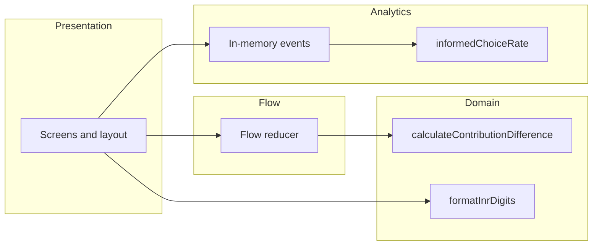
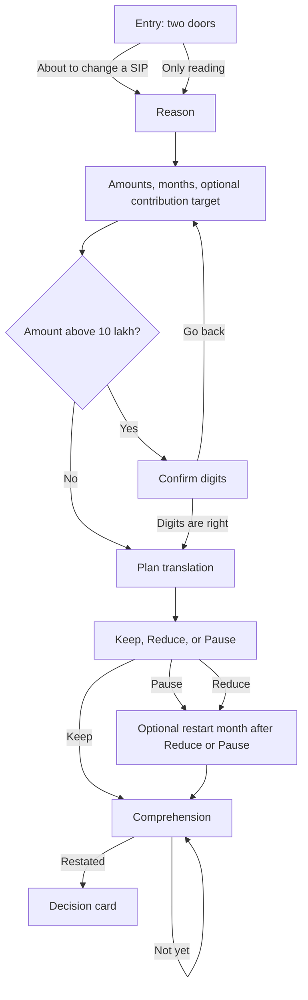

# Skip Check architecture

Skip Check is a local, client-only prototype. It compares future SIP contributions. It does not change a SIP, call a market API, or send figures to a server.

## System overview

The calculator is the only place the formula lives. Screens format the string it returns. They do not recompute it.

## User journey

The reading door uses the same screens with a persistent sample banner and sample analytics. It is not a decision session.

## Screen and component hierarchy

- `Shell` — column, header, sample banner, footer, privacy line
- `FlowApp` — reads reducer state and renders one step
- `Field` — label, hint, error
- `ChoiceButtons` — three equal options
- `MetricsPanel` — entry screen only, local counts, no amounts

## Domain model

`calculateContributionDifference` accepts the current amount, proposed amount, and months as strings so blank stays distinct from zero.

A successful result carries:

- `current`, `proposed`, `months`, `monthlyDifference`, `contributionDifference` as digit strings
- `mode`: `keep`, `reduce`, or `pause`
- `confirmationRequired` when either amount is above ₹10,00,000

Arithmetic uses `BigInt`, so a product larger than `Number.MAX_SAFE_INTEGER` is not rounded. Amount strings longer than 18 digits are rejected.

## State transitions

`flowReducer` is the only place a step can change. Impossible pairs, such as a recap without a final result, are not representable: `final` is set only when a choice validates.

Back returns to the previous step and clears a stale comprehension pass. Leave resets to the entry screen. Refresh remounts the module state only if the page reloads; React state is memory-only, so amounts disappear on refresh. Analytics events live in a module array and also disappear on refresh. They never include amounts.

## Analytics

Events use a session id, a kind (`decision` or `sample`), and optional reason or choice. Informed choice rate counts decision sessions that reached a valid card and also recorded a reason, a viewed calculation, a choice, and a passed comprehension check. Sample sessions are excluded. Continuing a SIP is not the numerator.

## Error handling

Invalid input stays on the input step with a field message. An application render error is caught by `ErrorBoundary`, which offers a reload and does not show a calculation. If the analytics array throws, the flow still renders; tracking is wrapped so a failed track does not block the screen.

## Privacy

No account, no broker credentials, and no payment. A saved assessment recap stays in this browser only after consent, and the person can delete it. Unsaved amounts clear on refresh. Analytics events stay in memory and do not include amounts or chat text.

SIP Check Bot calls Grok from the Vite server at `POST /api/sip-check`. `XAI_API_KEY` is read on the server. It is not prefixed with `VITE_` and is not sent to the browser. If the key is missing or the call fails, the assessment still runs. The model is not the source of the rupee arithmetic.

## Testing

- Unit tests cover the calculator, formatter, reducer, and funnel math.
- Component tests cover rendering, the high-amount gate, sample separation, and one full reduce path.
- Playwright covers the journeys in the brief, keyboard activation, a narrow viewport, and refresh.

## Accessibility

Native buttons, radios, and inputs. Errors use `aria-describedby` and `role="alert"`. The comparison is in an `aria-live` region. Focus rings are visible. `prefers-reduced-motion` removes transitions. Body text is 18px. Choice targets are at least 48px tall.

## Deployment

Vite development server and `vite preview` for the production build, both on the local machine. There is no hosted deployment in this prototype.

## Trade-offs

- A single column on a wide screen, rather than a dashboard, so the decision stays the only task.
- Oxlint ships with the Vite template; ESLint is also configured because the brief asked for it.
- No language model. The copy is fixed.
- Platform skip rules are not quoted. The research file showed conflicting cutoff numbers, and this prototype does not claim a broker's current rule.
